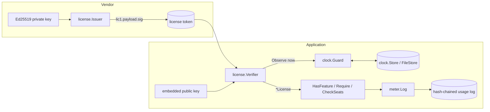

# go-license

[](https://github.com/neerajsinghi/go-license/actions/workflows/ci.yml)
[](https://pkg.go.dev/github.com/neerajsinghi/go-license)

**Offline license keys and feature gating for Go applications: Ed25519-signed tokens, clock-rollback detection and a tamper-evident usage log, using only the standard library.**

## Why it exists

Self-hosted and on-prem software often runs where it can't reach a licensing server: air-gapped networks, customer data centres, edge boxes. You still need to answer "who is this licensed to, until when, and which features are on?" without the network, and without trusting a config file the customer can edit.

go-license does that with public-key signatures. The vendor keeps an Ed25519 private key and signs licenses. The application ships only the public key, so it can verify a license but can't mint one. Two smaller pieces cover what offline checks usually miss: winding the system clock back, and editing usage records.

## Features

- **Compact signed tokens**: `lic1.<base64url JSON>.<base64url Ed25519 signature>`, about 300 bytes. Fits in a file, an env var or a support email.
- **Rich claims**: licensee, license ID, issued-at, not-before, expiry (or perpetual), seat and instance limits, feature flags, arbitrary string metadata.
- **Issuer / Verifier APIs** with typed errors you can match with `errors.Is`: `ErrMalformed`, `ErrUnsupportedVersion`, `ErrBadSignature`, `ErrExpired`, `ErrNotYetValid`, `ErrClockRollback`, `ErrFeatureNotLicensed`, `ErrLimitExceeded`, `ErrInvalidLicense`, `ErrInvalidKey`.
- **Feature gating**: `lic.HasFeature("sso")`, `lic.Require("sso", "audit")`, `lic.CheckSeats(n)`, `lic.CheckInstances(n)`.
- **Clock-rollback detection** (`clock`): records the latest time it has seen in a pluggable `Store` (an atomic, optionally HMAC-protected `FileStore` by default) and rejects time that moves backwards beyond a tolerance.
- **Tamper-evident usage metering** (`meter`): an append-only JSON-lines log in which each record's HMAC-SHA256 hash covers the previous record's hash. `Verify` detects edits, deletions, insertions and reordering, and with a checkpoint it also detects truncation of the tail.
- **CLI** (`golicense`): `keygen`, `issue`, `verify`, `inspect`.
- Standard library only, safe on hostile input (size limits, strict base64 and fuzzed parsing), safe for concurrent use.

## 30-second quickstart

```sh
go install github.com/neerajsinghi/go-license/cmd/golicense@latest

golicense keygen -priv vendor.key.pem -pub vendor.pub.pem
golicense issue  -key vendor.key.pem -licensee "Acme Corp" \
                 -features sso,audit -seats 25 -expires 365d -meta plan=enterprise -out acme.lic
golicense verify -pub vendor.pub.pem -require sso acme.lic
# OK: license 3f9c... for "Acme Corp", expires 2027-10-25T10:00:00Z, features [audit, sso]
golicense inspect -pub vendor.pub.pem acme.lic   # pretty-printed claims + signature status
```

`verify` exits 0 when the license is valid, 1 when it is not and 2 on usage errors, so you can use it in scripts. Add `-state clock.state` to turn on rollback detection between runs.

## Usage

```go
import (
	license "github.com/neerajsinghi/go-license"
	"github.com/neerajsinghi/go-license/clock"
)

//go:embed vendor.pub.pem
var pubPEM []byte

func loadLicense(token string) (*license.License, error) {
	pub, err := license.ParsePublicKey(pubPEM)
	if err != nil {
		return nil, err
	}
	guard := clock.NewGuard(clock.NewFileStore("/var/lib/myapp/clock.state", stateKey), 10*time.Minute)
	v, err := license.NewVerifier(pub, license.WithClockGuard(guard), license.WithLeeway(time.Minute))
	if err != nil {
		return nil, err
	}
	lic, err := v.Verify(token)
	switch {
	case errors.Is(err, license.ErrExpired):
		return nil, fmt.Errorf("your license has expired, please renew: %w", err)
	case errors.Is(err, license.ErrClockRollback):
		return nil, fmt.Errorf("system clock looks wrong: %w", err)
	case err != nil:
		return nil, err
	}
	return lic, nil
}

// Later, gate features:
if lic.HasFeature("sso") {
	enableSSO()
}
if err := lic.Require("audit"); err != nil {
	return err // *license.FeatureError listing the missing features
}
```

Issuing licenses from Go (in your vendor tooling):

```go
iss, _ := license.NewIssuer(priv)
token, err := iss.Issue(license.License{
	Licensee:  "Acme Corp",
	ExpiresAt: time.Now().AddDate(1, 0, 0),
	MaxSeats:  25,
	Features:  []string{"sso", "audit"},
})
```

Metering usage:

```go
log, err := meter.Open("/var/lib/myapp/usage.log", meterKey)
_, err = log.Append("export", 1, map[string]string{"user": "alice"})
cp := log.Checkpoint() // persist or report this to detect tail truncation

sum, err := meter.VerifyFile("/var/lib/myapp/usage.log", meterKey, meter.WithCheckpoint(cp))
// sum.Totals["export"], or errors.Is(err, meter.ErrTampered)
```

A complete runnable walkthrough is in [`examples/basic`](examples/basic/main.go): `go run ./examples/basic`.

## Architecture



The verifier works in this order: envelope and size checks, then the **signature**, then claim decoding, then the clock guard, then the validity window. Invalid tokens never get as far as advancing the rollback state.

Each meter record is one JSON line:

```
{"seq":N,"ts":...,"event":...,"qty":...,"meta":{...},"prev":hash(N-1),"hash":HMAC(key, record without hash)}
```

| Package | Responsibility |
| --- | --- |
| `license` (root) | claims, token encoding, `Issuer`, `Verifier`, key PEM helpers, feature/limit gating, typed errors |
| `clock` | `Guard`, `Store` interface, `FileStore`, `MemoryStore` |
| `meter` | append-only hash-chained `Log`, `Verify`, `Checkpoint` |
| `cmd/golicense` | CLI |

### Threat model, briefly

- Signatures stop anyone without the private key from forging or editing licenses.
- Rollback detection makes it harder to keep using an expired license by setting the clock back, but someone who controls the machine can still delete the state file. Treat a missing state file on an install that was already activated as suspicious.
- An attacker with the HMAC key can rebuild a usage log, and a key embedded in a binary can be extracted. Metering is tamper-*evident* against ordinary users, not proof against a determined reverse engineer. Checkpoints that leave the machine (reported to you or printed on an invoice) make it much harder to rewrite history quietly.
- No offline scheme survives someone patching your binary. go-license makes honest use easy and dishonest use deliberate.

## Roadmap

- [ ] Key rotation: verifiers that accept a set of public keys selected by a `kid` claim
- [ ] Hardware/instance binding helpers (machine fingerprint claim)
- [ ] Revocation lists (signed, offline-distributable)
- [ ] Rate-limited writes for `clock.FileStore` on hot paths
- [ ] Log rotation and segment checkpoints for `meter`
- [ ] `golicense meter verify` subcommand

## License

[MIT](LICENSE) © 2026 Neeraj Singhi
